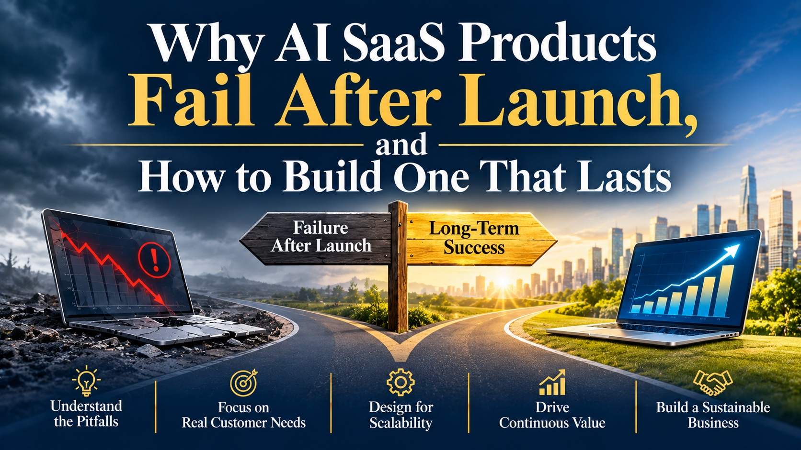

# Why AI SaaS Products Fail After Launch, and How to Build One That Lasts

*Understand the pitfalls. Focus on real customer needs. Design for scalability. Drive continuous value. Build a sustainable business.*

Launch day flatters every product. Interest is high, volumes are small, and costs are hidden. The real test arrives a few months later, when the novelty fades and customers decide whether the product earns a permanent place in their work.

Products that last are usually built as [Intelligent SaaS Solutions for Enterprise Growth](https://zignuts.com/ai-services/custom-ai-development/ai-saas-development-services?utm_source=seo_web2.0&utm_medium=backlink&utm_campaign=seo_referral&utm_id=11): focused on a clear customer job, priced to cover the cost of serving it, and improved continuously after release.

This workbook is a post-launch diagnostic. Use it to spot early warning signs, review the right numbers on a steady rhythm, and decide what to fix first.

---

## Failure Modes at a Glance

| What you see | Likely cause | First fix |
|---|---|---|
| Signups are strong, usage fades | The product solves a demo problem, not a daily one | Interview lapsed users about the job they hired it for |
| Revenue grows, margin shrinks | AI usage cost grows faster than price | Measure cost per active customer and adjust packaging |
| Support load keeps rising | Outputs are hard to trust or correct | Add sources, review steps, and easy feedback |
| Quality drifts over time | Data, prompts, or models change without testing | Keep an evaluation set and run it on every change |
| Large customers stall | Gaps in security, data isolation, or compliance | Close the top three questions from security reviews |
| The roadmap loses focus | Every request becomes a commitment | Tie each item to a measurable customer outcome |

## A Post-Launch Dashboard

Track these from the first month:

- Activation: how many new customers reach their first useful result
- Weekly active customers and task completion
- Retention by signup cohort
- Cost to serve per active customer, including AI usage and support
- Gross margin by plan
- Answer quality on a fixed evaluation set
- Support tickets per customer and time to resolve

## Review Rhythm

| Cadence | What to review |
|---|---|
| **Weekly** | Usage, errors, cost spikes, and support themes |
| **Monthly** | Retention cohorts, margin, evaluation results, and top feature requests |
| **Quarterly** | Pricing and packaging, roadmap against outcomes, security review, and what to stop |

## Pricing and Cost Questions

- What does one active customer cost us each month, including AI usage and support?
- Does our price rise when usage and cost rise?
- Which plan or segment loses money, and why?
- What would a price change do to the customers we most want to keep?

## Questions to Settle This Month

- [ ] We can state the customer job our product completes in one sentence
- [ ] We know our cost to serve per active customer
- [ ] We have an evaluation set that runs on every change
- [ ] A named person owns retention
- [ ] We know the three questions that stall large deals
- [ ] We have a rule for what the roadmap says no to

---

**Ready to build a product that lasts?** Visit [zignuts.com](https://zignuts.com/?utm_source=seo_web2.0&utm_medium=backlink&utm_campaign=seo_referral&utm_id=11) to speak with the team.
